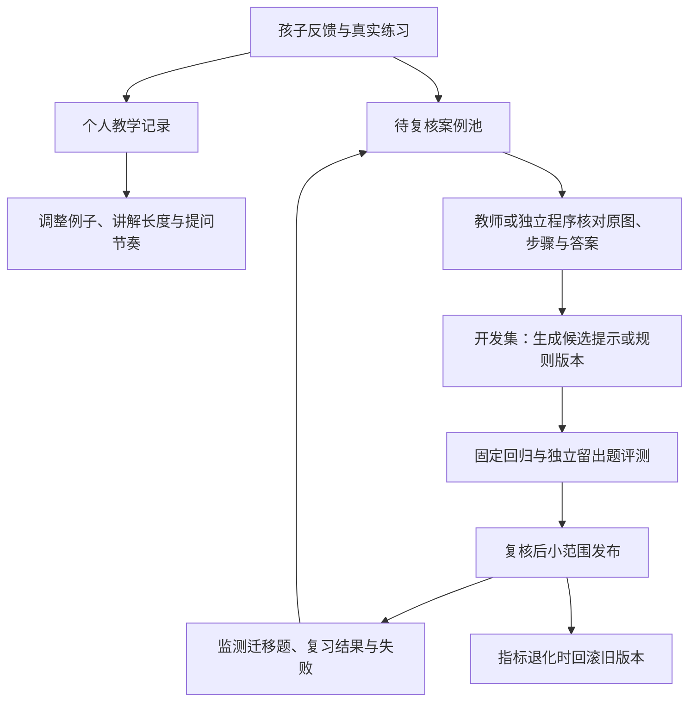

# 小树同学：持续改进与 RSI 边界

2026-11-14；对应 PRD 的 FR-013、FR-014。用户本次询问能否采用 RSI，本轮交付建议和反馈、版本、评测基础，不运行自动训练或自动发布。

## 可以做什么

智能体可以在使用中积累反馈和失败案例，改善讲法、选题与流程。通过 NextLabs 或厂商 API 调用模型，应用并不能直接更新该模型的权重；应把“针对孩子调整教学”和“经评测升级智能体版本”分开。

[Reflexion（NeurIPS 2023）](https://arxiv.org/abs/2303.11366)通过语言反馈和情景记忆影响后续行为，不更新模型权重。[STOP（COLM 2024）](https://arxiv.org/abs/2310.02304)研究由模型改进调用模型的程序；作者也明确区分这种方法与改变语言模型本身的完整 RSI。这些论文支持探索方向，不能证明某个数学教学产品会自动越用越准确。

## 建议分两条改进线

“听懂了”用于理解体验；“练习独立做对、隔天迁移题仍做对”用于学习证据。“可能有误”进入待复核队列，不能直接当作模型错误或标准答案。图形、提示和判题规则的正确性需要外部依据。

## 本轮已落地

- 网页针对当前题目提供“听懂了／再讲简单些／可能有误”，服务端关联题目和提示版本保存。再讲简单些会触发当前级别的简短追问；后续追问可参考最近反馈统计。
- 提示版本 `junior-20261114-v1` 和反馈的 `unreviewed` 状态可以追溯；反馈不会直接改动数学判定或点亮知识点。
- 旧代数验算回归保留；新增 LaTeX 运算、一元方程/不等式解集、定义域、初中基础练习、待核对分析和反馈闭环回归。
- 三类实拍选区已完成 Qwen 读图与 GPT 教学调用：运算、概率、函数应用；函数页额外比较 GPT 读图。原图与详细输出只在忽略版本管理的本机数据目录，不作为公开网页资源。

这属于持续改进的基础设施，还没有实现自动搜索候选提示、自动修改代码、在线训练或自动灰度发布。

## 怎样评测，才能防止“自我感觉更好”

1. 每道题分别保存原图选区、逐字题干、原样学生步骤、必要图形条件、独立参考答案与核验等级。先核对人工参考，不能直接把红笔勾或模型回答当作金标。
2. 按题目/试卷来源划分开发集与留出集；同题的旋转、裁剪和重拍版本不能分到两边。当前六页主要来自同一份试卷，不足以作为泛化评测集；本次用过的题只能算开发/冒烟样本。
3. 比较旧版本与候选版本的题干和作答转录保真、首错定位、数学结论、低级提示泄露、无依据判错、图形条件遗漏、孩子迁移题表现，以及耗时和 token。模型自评分只能帮助筛查，不能作为发布分数。
4. 数学验算器、留出答案和发布门槛由维护者控制；候选模型不能改写它们。几何证明由教师或独立严格工具复核，未复核时保留“AI 分析，尚待核对”。
5. 先做离线对照，再由维护者决定小范围发布；记录提示、程序和模型配置版本。发布失败或学习指标退化应可回退。具体门槛须由足够样本实测制定，目前不编造准确率或提分承诺。

## 本次实拍暴露的问题

计算题能识别、验算并完成学习闭环；概率题能保留题干并提供讲解，完整推理仍是待核对的 AI 内容。函数应用题中，Qwen 把学生草稿整理成了更完整的结论；GPT 混入邻题笔迹。两者均不能按“返回了 JSON”算识别成功。

另一个教训来自人工参考：初看把题干关系误读为严格大于，放大原图后确认是大于等于，参考区间已更正为闭区间。这说明金标也需要复核；不能用错误参考去优化提示。当前小样本不足以选出普遍更好的国内/国外模型，继续保留识别确认和可独立配置的视觉/文本模型。
