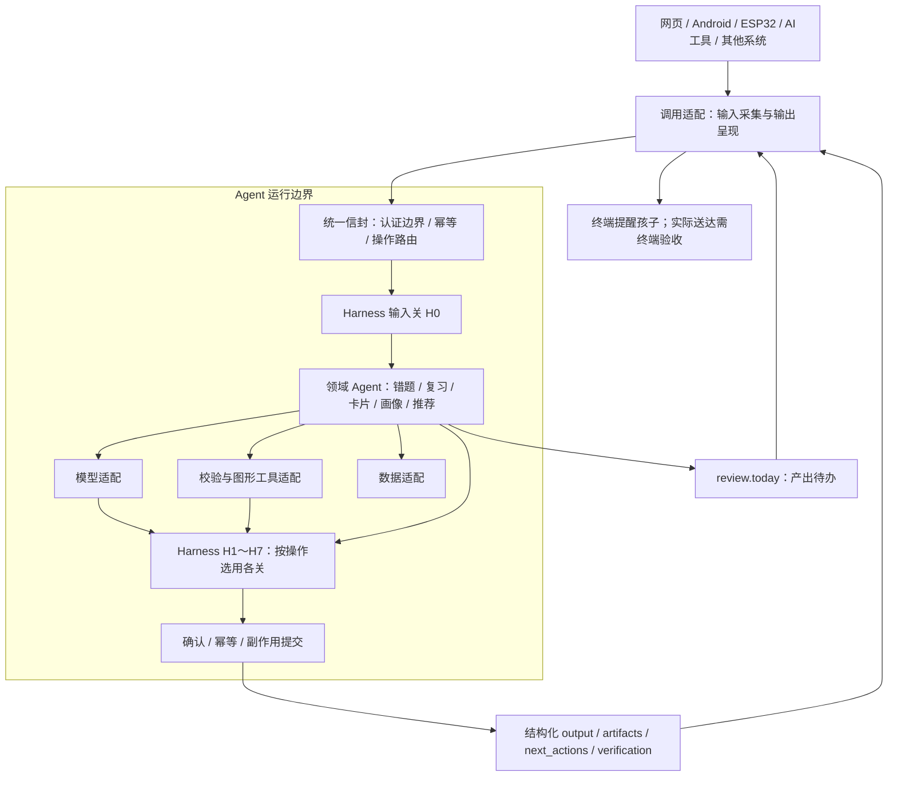
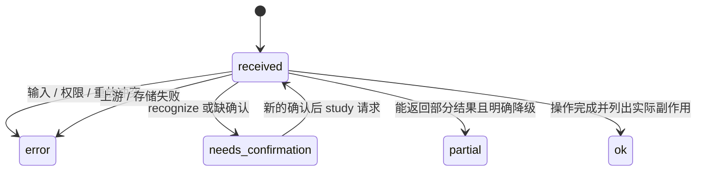

# 小树学习 Agent · 目标架构与输入输出

依据：[Claude ARCH-001](../collaboration/ARCH-001.md)、[PRODUCT-001](../collaboration/PRODUCT-001.md)、[PRODUCT-002](../collaboration/PRODUCT-002.md) 与 [PRD v2.3](../PRD.md)。阶段 A 已通过架构文档验收；当前 B 阶段按 [任务单](../collaboration/B-PHASE.md) 实现业务。尚未迁移为独立部署服务。本文件由 Codex 按 Claude 决定整理，当前验收由 Astra 负责。

## B 阶段当前映射

- `POST /api/agent` 已有识别、整理、卡片、复习、检验、解锁、个人树及成长主线；`tools/e2e_loop_check.py --require-complete` 本次正式复跑12/12段通过。旧路由与辅助hint/ack/snooze保留。
- 第3级提示由服务端发放并记录，原题与检验题分开；检验组不下发答案，作答和U1～U5由服务端判断。运行样例以 `examples/runtime` 的HTTP归档为准。
- `GET /api/quiz/lesson` 是只读辅助接口（不增加23操作），返回本档案匹配来源卡的参考规则与服务端暂停/恢复日；不写盘、不调模型、不发检验答案/H3。字段与400/404/503边界由QuizLessonQuery/Output/Error定义，HTTP实现与暂停/次日恢复已通过Astra的ASTRA-B-001独立复验。
- macOS提醒客户端13项单测、实际复习服务联调及c2_probe日志模式21项通过；真实系统通知可见性和登录代理安装仍未确认，不等于G3通过。
- 网页原流程25项与暂停交互17项已由Astra独立复跑，含指针拖拽、键盘与菜单、390/1440布局；未实测物理手机触屏。
- 用户指定Astra接替Claude指导。G1是Claude历史通过；Astra已通过G2/G4/G5/G6；G3未验证，G7待最终资料复核。没有整体闭环验收通过声明。
- 当前匿名档案、参考目录及单JSON存储的边界不变；真实多用户排行、正式画像推荐、Android/硬件接入仍待后续。下文阶段A映射保留为历史基线。

## 产品主线与成果

- 定位：帮助孩子将错题转成可探索的知识，主动复习，亲手编排个人知识树；对话是围绕卡点探索的手段。
- 输入：题目照片 / PDF 页图、孩子原样作答、确认后的文本、复习与练习表现、主观反馈、自己的笔记与偏好。
- 输出：错题卡、带具体任务的复习待办、答对检验后获得的知识卡、孩子编排的树、三层学习者画像、附依据的迁移 / 进阶推荐；树成长与排行待具体规则和多用户基础完成。
- 闭环：拍题 → AI 整理错题卡 → 到期复习待办 → 终端提醒 → 孩子探索 / 适度练习 → 答对检验解锁知识卡 → 孩子整理树 → 成长反馈与投入 → 画像更新 → 下一步推荐。
- C1错题卡、C3检验解锁、C4个人树已有实现及Astra独立复验；C2客户端已联调、可见通知待验，C5画像驱动推荐仍待后续。只读目录与被动复习不代替这些能力。

## 分层与可移植边界

- 客户端：网页、Android、ESP32、外部 AI 工具及其他系统。采集输入、预览 / 选区、申请设备权限、展示结构化输出、按终端能力提醒。
- 调用层：同一请求 / 响应信封；负责认证边界、输入校验、请求幂等与操作路由。当前已提供统一HTTP入口，MCP等其他协议适配仍待后续，不为各终端复制业务规则。
- Agent 核心：编排错题整理、探索、复习、卡片、画像与推荐；业务规则集中，依赖适配器，不依赖 DOM、HTTP、具体模型厂商或存储实现。
- Harness：覆盖一次运行的输入和输出关；限制与校验模型 / 工具结果，统一核验等级、失败处理、降级与记录。
- 适配层：模型、符号校验 / 图形工具、档案 / 卡片 / 复习数据的接口注入。模型只是其中一类资源。
- 可接入不同系统表示调用契约与领域核心可复用，不表示 Android、硬件或外部工具已经接入。当前仍是初中数学领域。

## Harness H0～H7

- H0 输入：大小、格式、字符、步数、请求幂等；失败返回具体错误。现有解析、文件边界与统一入口已实现，按各操作验证边界。
- H1 结构：模型输出符合 Schema；不合格不放行。当前统一入口按权威Schema运行时校验；不合格拒绝，受控重试规则仍按具体适配落实，不暗中重复付费。
- H2 数学：程序核验其支持的数学结论；无法核验标 ai_review / unavailable，不把 AI 判断当成记错或点亮依据。已有代数与部分一元关系基础。
- H3 教学法：按提示等级引导，低级提示不泄露最终答案；失败回退并标注。已有相关检查和回归。
- H4 口吻：具体、可理解，不贴标签；重写或回退。待实施。
- H5 安全：情绪类表达按预设策略处理并提示监护人关注。待实施，不以模型自由判断替代策略。
- H6 语音口语化：公式转口语、控制长度，按终端能力提供简版文本。待实施，语音适配当前未配置。
- H7 读图依据：按 DESIGN-001 用学生同题书写消歧，保留真实错误与候选；不足时核对。独立任务执行 / 验收中，不因设计写入就标通过。

各关按操作适用范围执行，**不是每个操作依次跑八次模型**。开关由服务端策略控制；客户端不能请求关闭数学、确认或权限边界。`harness.gates` 报告执行结果，核验等级统一为 verified / ai_review / unavailable，且说明核验对象；不将一个等式通过扩写成整份解释均正确。

## 统一输入与输出

- 唯一权威形状：[agent-contract.schema.json](agent-contract.schema.json)，JSON Schema 2020-12。文档和图是其视图，不另维护终端专属字段表。
- 请求必填：schema_version、operation、request_id、client.type、subject.profile_id、input；options 可选。客户端类型只有 web / android / esp32 / tool / other。
- 响应状态：ok / needs_confirmation / partial / error。每次返回 verification 与 effects；按状态要求 output、next_actions、harness 或 error。
- output 是结构化领域结果；artifacts 是 markdown / latex / 程序 SVG / audio_ref。语音未配置时不返回虚构音频；硬件按 capabilities 消费可用载体。
- 操作共 23 个：原 9 个，加 PRODUCT-001 的 10 个，移除直接创建知识卡操作，再新增 quiz.start / quiz.answer / card.unlock / growth.get / leaderboard.get。每个 input / output 有独立定义；未知操作拒绝。
- 传输与认证方案待后续落实；profile_id 当前只是匿名本机引用，不是身份凭据。请求和信封不承载模型密钥。

## 确认、状态与副作用

- recognize 不写学习记录，返回 reading_id、候选 / 推断依据与 needs_confirmation；PDF 页预览是调用适配层预处理，核心接收选定页图。
- study 必须带 confirmed_reading_id 与最终确认文本。已采用推断的读法同样要展示依据并可改；确认前不做学习进度更新。
- 同 profile_id + operation + request_id 的同内容重试返回首次结果，不重复模型调用或写入；不同内容返回 CONFLICT。B阶段卡片/检验/树等写操作已按此实现并测试，其他旧适配不能仅据文档视为完整覆盖。
- needs_confirmation / error 的 effects 必须是空数组；写入失败返回 STORAGE_FAILED，不能同时显示保存成功。
- effects 明确列出诊断、错题卡、知识卡、编辑、移动、画像、复习、练习与反馈等变更；只读操作没有效果项。
- schema 不能核对事实编号是否真实存在、跨记录引用、用户权限或数学真值。这些必须由服务端语义校验和 Harness 实现，不能以 Schema 通过代替。

## 卡片、画像与知识树规则

- 知识卡通过 U1～U5 解锁：三题至少两题合格正确，其中至少一道迁移；三题均 verified；计入解锁的正确题不用第 3 级完整解法；全组由服务端保存。来源至少一张错题卡，正确性和提示记录不接受客户端自报。题数是起点、待数据。
- card.unlock 返回 U1～U5、服务端检验依据及结果；unlocked=true 必须带全部通过的证据和知识卡。未达标返回原因且 effects=[]；review.complete 仅完成复习不能自行认定解锁资格。
- U4 的 max_hint_level 是服务端提示访问记录，不能由客户端自报。B 阶段已实现原题的受控提示访问；检验题范围的关联与前端调用仍待 T4 / T7 验证，在此之前不得声称已经强制 U4。
- 同一知识点复用一张知识卡。孩子编辑标题与笔记；移除知识卡不删除来源错题或历史事实。
- 树的父子、分组与位置由孩子决定，课标目录是参考骨架；保留撤销，并提供键盘 / 菜单移动样例。家长只读。
- 画像分 facts / inferences / preferences。推断必须 based_on 非空事实引用，可被孩子反驳；主观“懂了”不直接改变掌握状态。
- 掌握状态只有 not_started / consolidating / stable。初始 stable 参数：间隔至少 3 天的两次独立正确、最近一次无提示；该参数是 Claude 的起点，待教学反馈校准。
- 推荐都有 reason / based_on；advance 还须前置 stable 证据。无证据不进阶，练习需可核验；AI 的改进通过版本、评测与审查控制。
- review.today 最多 3 项并附具体任务，终端决定如何提醒。打开页面时的待办展示不能证明应用外提醒已送达。

## 激励与成长规则

- 初始难度目标 60%～80% 可答对；全组三题无提示全对升一档、两题对保持、至多一题对降档给支架，连续两组至多一题对返回讲解。难度用程序题目属性；可随时结束，超前仍需 stable。这些均为起点、待数据。
- 初始成长分：每张首次解锁知识卡 +10；间隔至少 3 天的 verified 正确复习每次 +3、每点最多 3 次；目录前置关系一致的连线 +2、最多计 20 条。计分和上限均为起点、待数据。
- 关系由知识编号判断，不按像素；孩子自建联系保留理由，目录未收录则不计分不判错，反向只提示一次。模型评论不能决定计分；新建关系输入需 relation_reason。
- 三部分明细之和必须等于总成长分，growth.get / leaderboard.get 的样例另做算术验证，不能宣称 Schema 可以求和。服务端还须核对记录、去重、间隔与上限；客户端不上传分数。
- 规模 / 关联按知识点 ID、带方向的知识点对去重，不能使用可重建的卡片 / 连线 ID 充当计分键。布局删除 / 撤销不冲掉历史成长，重建也不重复授分；这一事件机制仍待实施。
- 榜单按授权小组的每周成长增量，只含昵称、分数、树缩略图；可退出，不公开错题与画像。当前没有真实多用户榜，依赖 FR-018。
- 本阶段不做随机酬赏，不扣分、不衰减、不让树枯萎；笔记与自己整理的知识关系构成投入，下一轮推荐可引用它们，当前尚未实现。

## 阶段 A 接口与字段映射（2026-11-14 17:25历史基线）

下表记录阶段 A 当时的迁移差距，保留用于审查前后变化。B 阶段已有部分统一入口，最新实现以本文开头的 B 阶段映射与 [真实 HTTP 样例](examples/runtime/) 为准。尚未捕获的操作仍只具备历史投影 / 设计样例，不能据此声称运行通过。

| 操作 | 当前接口 / 字段 | 目标投影与差距 |
|---|---|---|
| recognize | POST /api/recognize：student、image_data | student → subject.profile_id；正文到 input；识别结果到 output，reading_id 为目标字段；确认无副作用 |
| study | POST /api/study；旧 /api/diagnose、/api/learn | problem / steps / recognition → input；analysis / diagnosis_id → output；缺独立错题卡时投影 partial，不补造卡片 |
| chat | POST /api/chat：diagnosis_id、question、level、history | 业务字段 → input；reply / equations / fallback / source → output，meta → 信封；不改保存的判题真值 |
| practice.create | POST /api/practice：diagnosis_id 或 review_id | input 二选一；kp / items → output；目标 effects 列练习创建 |
| practice.check | POST /api/practice/check：exercise_id、answer | 正确与否 / message / duplicate → output；目标统一幂等与 effect 记录待实现 |
| schedule.set | POST /api/availability：availability | availability → input / output；复习重排保留；统一 envelope 去重尚无 |
| profile.get | GET /api/profile?student=… | 计数和原记录 → facts 投影；availability → preferences；当前没有推断与 stable 证据，不凭点亮补造 |
| feedback.add | POST /api/feedback：diagnosis_id、rating、issue | 字段 → input；ok → recorded，message 原样；主观反馈不改判题真值 |
| speech | POST /api/speech：当前固定 503 | SPEECH_NOT_CONFIGURED → MODEL_NOT_CONFIGURED；成功音频输出仍待实施 |
| review.today / review.complete | 没有 | 待实施：今日任务和复习完成证据；旧 review 列表不是主动提醒 |
| card.list / card.edit / card.unlock | 没有 | 待实施：独立卡片、来源、U1～U5 检验资格、一次解锁与编辑 |
| tree.get / tree.move | 旧 profile.tree 为只读目录 | 待实施：个人卡片位置、分组、连线、撤销与非拖拽方式 |
| profile.set_preference / profile.dispute | 只有单独 availability 接口与反馈记录 | 待实施：三层画像偏好与对具体推断的反驳 |
| recommend.next | 没有 | 待实施：有理由、事实引用和前置 stable 依据的推荐 |
| quiz.start / quiz.answer | 没有；普通 practice 不是检验组 | 待实施：服务端保存三题、题目难度与迁移标注、提示访问记录、作答和幂等 |
| growth.get | 没有 | 待实施：三部分成长、证据引用、周期增量与去重累计 |
| leaderboard.get | 没有 | 待实施：小组授权、每周增量榜、隐私投影；依赖 FR-018 |

PDF 的 `/api/files/preview` 保持在输入适配 / 预处理侧，不计入 23 个 Agent 操作。旧路由继续可用，阶段 A 不修改服务。

## 样例来源与校验边界

- [runtime](examples/runtime/)：12个操作的真实本机HTTP请求/响应，隔离档案与本地假模型；归档源SHA与响应逐字校对。是运行证据，不代表真实OCR质量或通知送达。
- [current](examples/current/)：7 份既有 HTTP 归档 + 2 次隔离现场生成的输出投影。排期 / 语音错误由 tools/capture_agent_examples.py 调用临时档案生成，未留存原始 HTTP 响应字节，已解析 JSON 保留在 current-http-sources.json；没有新模型调用或演示档案写入。
- 统一信封、reading_id、事实编号等标为契约元数据；请求是独立协议样例，不伪装成原始抓包。诊断缺新错题卡对象时使用 partial。
- [design](examples/design/)：14 个新目标操作的设计场景，**不是现有接口返回**。不与当前接口样例混放，不作为产品效果证据。
- [invalid](examples/invalid/)：缺必填、确认时写入、推断缺事实、知识卡缺来源、进阶缺 stable 证据、待办超 3 项和未知操作等必须被拒绝的反例。
- [verification.json](verification.json) 记录实际 Schema 检查；统一入口12段HTTP已复验；终端通知实际可见、跨设备和真实学习效果仍待验证。

## 阶段与交接

- A：当前交付 PRD、Xmind、交互架构图、23 操作 Schema、样例与映射表，由 Claude 按 ARCH-A / PROD-A / INC-A 验收；不重构 mytree/app。
- DESIGN-001：由另一 Codex 会话按 Claude 的任务继续，和本阶段资料工作分开。
- B1：错题卡对象化；B2：知识卡与孩子的树；B3：画像与复习待办；B4：依据真实事实数据推荐。其中卡片、树、待办已交付自测；Astra继续独立验收与后续推荐任务指导，不把方案当作当前交付。
- 外部协议封装、正式账号授权、系统通知和硬件接入另行明确；不影响本次目标契约的可读性与校验。

## 图示来源与离线导出

- 项目内可维护的图示源为 [agent-harness.fragment.html](agent-harness.fragment.html)；仓库离线页面由此生成；旧对话内联图是阶段A历史快照，本次未更新该内联副本。
- 导出先调用 visualize skill 的 `render.py` 生成完整页面，再由 `tools/export_agent_visual.py` 去除本图未使用的三个 CDN 帮助脚本，收紧内外 CSP，并递归检查 iframe 的资源引用。直接运行 render.py 的结果仍可能依赖网络，不能直接标离线。
- 运行 `python3 tools/export_agent_visual.py docs/architecture/agent-harness.fragment.html --renderer <visualize技能目录>/scripts/render.py`；生成 [agent-harness.html](agent-harness.html)。结果与实际界面复验记录在 [visual-verification.json](visual-verification.json)。
